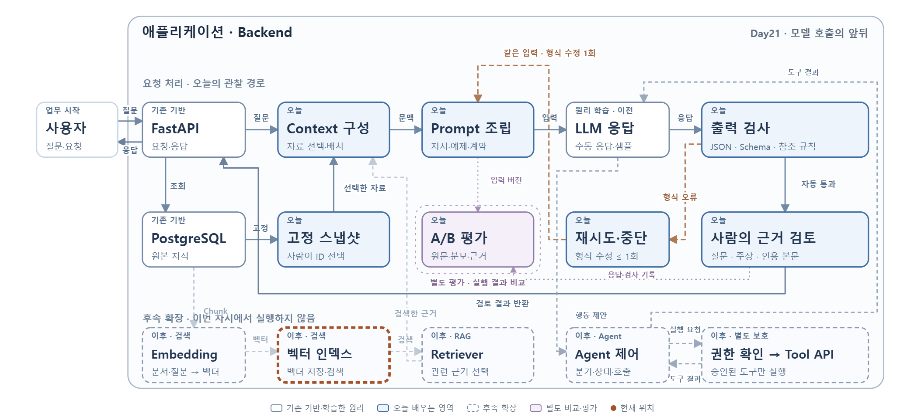

# 2026-11-16 / D21 실습 노트: 프롬프트 설계부터 검증·재시도 정리 (1교시 ~ 8교시)

> **오늘의 학습 목표 요약**
> * LLM을 활용한 질의응답 파이프라인의 전 과정을 **설계 → 문맥 관리 → A/B 실험 → 엄격한 스키마 검증 → 안전 재시도 → 문서화 및 요약본 + 배포(Git)** 단계별로 이해하고 구현합니다.
> * 미완성 및 오답이 있는 실습 코드(2, 4, 6교시)는 **원본 코드를 그대로 보존**하고, 바로 아래나 옆에 `# [정답 주석]`으로 올바른 코드를 달아 복습하기 쉽게 정리했습니다.

---

## 목차
1. [1교시 (`D21-01`): 프롬프트 6대 요소 설계 및 템플릿 바인딩](#1교시-d21-01-프롬프트-6대-요소-설계-및-템플릿-바인딩)
2. [2교시 (`D21-02`): Few-shot 예제 구성 및 Zero-shot 비교 실험 설계](#2교시-d21-02-few-shot-예제-구성-및-zero-shot-비교-실험-설계)
3. [3교시 (`D21-03`): 질문 분해와 근거 대조 (Fact Card 분석)](#3교시-d21-03-질문-분해와-근거-대조-fact-card-분석)
4. [4교시 (`D21-04`): 가상 토큰 예산 계산 및 컨텍스트 매니페스트 작성](#4교시-d21-04-가상-토큰-예산-계산-및-컨텍스트-매니페스트-작성)
5. [5교시 (`D21-05`): 근거 부족 규칙 A/B 실험 및 첫 응답 기준 집계](#5교시-d21-05-근거-부족-규칙-ab-실험-및-첫-응답-기준-집계)
6. [6교시 (`D21-06`): Pydantic v2 엄격 스키마 검증 및 비즈니스 규칙 검사](#6교시-d21-06-pydantic-v2-엄격-스키마-검증-및-비즈니스-규칙-검사)
7. [7교시 (`D21-07`): 형식 오류 한정 자동 재시도(Retry) 제어 흐름](#7교시-d21-07-형식-오류-한정-자동-재시도retry-제어-흐름)
8. [8교시 (`D21-08`): 학습 내용 마크다운 정리 및 요약본 작성](#8교시-d21-08-학습-내용-마크다운-정리-및-요약본-작성)

---

## 1교시 (`D21-01`): 프롬프트 6대 요소 설계 및 템플릿 바인딩

### 핵심 개념
* **프롬프트 6대 요소**: `role`(역할), `task`(작업), `input`(입력), `constraints`(제약), `failure`(실패 처리), `output`(출력 형식)을 명확히 분리해 정의합니다.
* **데이터와 지시의 분리**: 지식 본문(`context_json`)을 `Template`에 대입하는 것은 단순 문자열 치환일 뿐 코드 실행이나 보안 권한 부여가 아닙니다. 역할을 전문가로 꾸미는 것보다 정확한 근거를 제공하는 것이 중요합니다.

### 소스코드
```python
def build_requirements():
    # 해설 D21-01-B01: 역할·작업·입력·제약·실패·출력 여섯 칸을 완성하세요.
    # 입력·대상: PPT 8장의 여섯 요소
    # 완료 기준: 6개 키가 모두 있고 각 문장이 비어 있지 않습니다.
    # 핵심: 역할을 전문가로 꾸미는 것과 정확한 근거를 제공하는 것은 다릅니다.
    # BEGIN D21-01-B01
    requirements = {
        "role": "초보 수강생의 실습 도움말 작성자",
        "task": "제공된 지식으로 질문에 한국어 2문장 이내로 답합니다.",
        "input": "사용자 질문과 선택한 지식 목록",
        "constraints": "제공된 근거만 사용하고 예제 ID를 답에 복사하지 않습니다.",
        "failure": "답을 뒷받침하는 사실이 없으면 정보 부족을 명시합니다.",
        "output": "status, answer, source_ids, missing_information 네 필드 JSON",
    }
    # END D21-01-B01
    return requirements

def build_prompt(question, rows, requirements):
    # 해설 D21-01-B02: Template에 질문·직렬화한 지식·출력 계약을 대입하세요.
    # 입력·대상: question, rows, requirements; CONTRACT_TEXT는 제공 코드
    # 완료 기준: 질문·지식 원문·네 필드 약속이 prompt에 있으며 $question이 남지 않습니다.
    # 핵심: 지식 본문은 데이터입니다. Template 대입은 코드 실행 또는 보안 권한 부여가 아닙니다.
    # BEGIN D21-01-B02
    context_json = json.dumps(rows, ensure_ascii=False)
    template = Template("[역할] $role\n[작업] $task\n[입력] $input\n[질문] $question\n[지식 데이터] $context_json\n[제약] $constraints\n[실패] $failure\n[출력] $contract")
    prompt = template.substitute(**requirements, question=question, context_json=context_json, contract=CONTRACT_TEXT)
    # END D21-01-B02
    return prompt

def main():
    requirements=build_requirements()
    rows=read_json(DATA / "knowledge_v1.json")[:1]
    prompt=build_prompt("파일을 어디에 보관하나요?",rows,requirements)
    # 해설 D21-01-B03: 요구사항과 Prompt 원문을 저장하고 기준 질문을 확인하세요.
    # 입력·대상: 아래 함수 인자와 제공 데이터만 사용합니다.
    # 완료 기준: outputs/requirements.json 및 prompt.txt 생성. 아직 실제 모델 품질 결과는 없습니다.
    # BEGIN D21-01-B03
    assert len(requirements) == 6 and all(requirements.values())
    assert "파일을 어디에 보관하나요?" in prompt and "개인 폴더" in prompt
    write_json(HERE / "outputs" / "requirements.json", requirements)
    write_text(HERE / "outputs" / "prompt.txt", prompt)
    # END D21-01-B03
    print("[01] Prompt 요구사항과 원문 저장 완료. 모델 결과가 아닙니다.")

if __name__ == "__main__":
    run(main)
```

---

## 2교시 (`D21-02`): Few-shot 예제 구성 및 Zero-shot 비교 실험 설계

### 핵심 개념
* **정상 응답 vs 정보 부족 응답 예제**: Few-shot 예제에는 근거가 있는 정상 응답(`answered`, `source_ids: [901]`)과 근거가 없을 때 할루시네이션을 막는 거절 응답(`insufficient_context`, `source_ids: []`)을 모두 포함해 출력 계약을 학습시킵니다.
* **평가 데이터 오염 방지**: 평가용 질문(`dev_v1.json` 등)은 절대 Few-shot 예제로 사용하지 않으며, 예제를 추가해도 모델의 가중치(Weights)가 변하는 것은 아닙니다.

### 소스코드 (원본 유지 + 정답 주석 포함)
```python
def build_examples():
    # TODO D21-02-B01: 예제 ID 901을 사용해 정상 답과 정보 부족 답을 완성하세요.
    # 입력·대상: 아래 함수 인자와 제공 데이터만 사용합니다.
    # 완료 기준: 정상·부족 예제 2개. 평가 질문 D/H를 Few-shot에 사용하지 않습니다.
    # 핵심: 입력 예제를 늘려도 모델 가중치가 바뀌는 것은 아닙니다.
    # BEGIN D21-02-B01
    example_context = [{"id":901,"content":"대여 장소는 안내 데스크입니다."}]
    examples = [
        {"question":"어디서 대여하나요?","context":example_context,
         "answer":{"status":"", "answer":"", "source_ids":["안내 데스크에서 대여 가능합니다."], "missing_information":""}},
        {"question":"대여료는 얼마인가요?","context":example_context,
         "answer":{"status":"", "answer":"", "source_ids":["그 질문에는 답변 드릴 수 없습니다."], "missing_information":""}},
    ]
    # [정답 주석 - D21-02-B01]
    # - status에는 "answered" / "insufficient_context"를 명시해야 합니다.
    # - answer에 답변 문장을 넣고, source_ids에는 문자열 문장이 아닌 정수 ID 리스트([901] 또는 [])가 들어가야 합니다.
    # - 정보 부족 시 answer는 고정 거절 문구(INSUFFICIENT), missing_information에는 부족한 사실("대여료")을 적습니다.
    # examples = [
    #     {"question": "어디서 대여하나요?", "context": example_context,
    #      "answer": {"status": "answered", "answer": "안내 데스크에서 대여할 수 있습니다.", "source_ids": [901], "missing_information": ""}},
    #     {"question": "대여료는 얼마인가요?", "context": example_context,
    #      "answer": {"status": "insufficient_context", "answer": "제공된 정보만으로는 답변할 수 없습니다.", "source_ids": [], "missing_information": "대여료"}},
    # ]

    # TODO: 정상 답에는 [901], 정보 부족에는 []와 부족한 사실 이름을 사용합니다.
    #raise NotImplementedError("D21-02-B01: 골격의 TODO를 채운 뒤 이 줄을 삭제하세요")
    # END D21-02-B01
    return examples

def main():
    examples=build_examples()
    # TODO D21-02-B02: 같은 질문에 Zero-shot과 Few-shot Prompt를 각각 만드세요.
    # 입력·대상: 아래 함수 인자와 제공 데이터만 사용합니다.
    # 완료 기준: 두 Prompt가 생성됩니다. 이는 05의 근거 규칙 A/B와 별도 설계 실험입니다.
    # BEGIN D21-02-B02
    case = read_json(DATA/"dev_v1.json")[0]
    zero_bundle = make_bundle(examples=[])     # 예제 없는 입력
    few_bundle = make_bundle(examples=[examples])      # TODO: examples 사용
    # [정답 주석 - D21-02-B02] examples는 이미 리스트이므로 한 번 더 대괄호로 감싸지 않고 그대로 전달합니다.
    # few_bundle = make_bundle(examples=examples)

    zero_prompt, _ = render_prompt(zero_bundle, case, "A")
    few_prompt, _ = render_prompt(few_bundle, case, "A")
    assert "901" not in zero_prompt and "901" in few_prompt
    # TODO: 예제 ID 901의 포함 여부를 확인
    #raise NotImplementedError("D21-02-B02: 골격의 TODO를 채운 뒤 이 줄을 삭제하세요")
    # END D21-02-B02

    # TODO D21-02-B03: 변경점·가설·고정 조건과 두 Prompt를 저장하세요.
    # 입력·대상: 아래 함수 인자와 제공 데이터만 사용합니다.
    # 완료 기준: 가설을 실제 성능 결과처럼 기록하지 않습니다.
    # BEGIN D21-02-B03
    experiment = {
        "experiment":"examples_design_only", "base_version":"examples_zero_v1", "new_version":"examples_few_v1",
        "changed":"미래", "hypothesis":"터미네이터", "fixed":["존 코너를 지켜내는데 실패"], "source_mode":"design_only"
    }
    # [정답 주석 - D21-02-B03] 유머러스한 임시 값 대신 실험 변인(예제 유무), 가설, 통제 변인을 명확히 기록해야 합니다.
    # experiment = {
    #     "experiment": "examples_design_only", "base_version": "examples_zero_v1", "new_version": "examples_few_v1",
    #     "changed": "examples_0_to_2",
    #     "hypothesis": "정상 및 정보 부족 예제를 2개 제공하면 JSON 형식과 거절 규칙 준수율이 높아질 것이다.",
    #     "fixed": ["question", "context", "rule_a", "contract"],
    #     "source_mode": "design_only"
    # }

    # TODO: 예제 유무를 바꿨다는 기록과 고정 조건을 작성
    write_json(HERE/"outputs"/"examples.json", [])  # TODO: examples
    # [정답 주석 - D21-02-B03] 빈 리스트([]) 대신 examples 변수를 저장합니다.
    # write_json(HERE/"outputs"/"examples.json", examples)

    write_json(HERE/"outputs"/"experiment.json", experiment)
    write_text(HERE/"outputs"/"zero_prompt.txt", "")  # TODO: zero_prompt
    write_text(HERE/"outputs"/"few_prompt.txt", "")   # TODO: few_prompt
    # [정답 주석 - D21-02-B03] 빈 문자열("") 대신 생성된 zero_prompt와 few_prompt를 저장합니다.
    # write_text(HERE/"outputs"/"zero_prompt.txt", zero_prompt)
    # write_text(HERE/"outputs"/"few_prompt.txt", few_prompt)

    #raise NotImplementedError("D21-02-B03: 골격의 TODO를 채운 뒤 이 줄을 삭제하세요")
    # END D21-02-B03
    print("[02] 예제·버전 설계 완료. 05는 예제 고정, 근거 규칙만 비교합니다.")

if __name__ == "__main__":
    run(main)
```

---

## 3교시 (`D21-03`): 질문 분해와 근거 대조 (Fact Card 분석)

### 핵심 개념
* **명시적 판단 기준**: 질문이 요구하는 사실(`required`)과 제공된 문서가 뒷받침하는 사실(`supported`), 그리고 모순 여부(`conflicts`)를 대조합니다.
* **엄격한 중단 원칙**: 요구되는 사실 중 단 하나라도 빠지거나(`missing`) 충돌이 발생하면 부분 답변을 임의로 지어내지 않고 즉시 `insufficient_context` 상태로 멈춥니다.

### 소스코드
```python
def analyze_card(card):
    # 해설 D21-03-B01: 질문이 요구하는 사실과, 제공 자료가 지원하는 사실을 구분하세요.
    # 입력·대상: 교사가 작성한 required/supported/conflicts 카드
    # 완료 기준: C01 missing=[], C02 missing=[보관 기간]
    # 핵심: 이 코드는 자유로운 질문의 의미를 자동 이해하지 않습니다. 명시된 판단 카드를 처리합니다.
    # BEGIN D21-03-B01
    required=list(card["required"])
    supported=card["supported"]
    missing=[fact for fact in required if fact not in supported]
    conflicts=list(card["conflicts"])
    # END D21-03-B01
    # 해설 D21-03-B02: 하나라도 근거가 부족하면 수업의 정보 부족 상태를 선택하세요.
    # 입력·대상: 아래 함수 인자와 제공 데이터만 사용합니다.
    # 완료 기준: README의 예상 결과와 출력 파일을 대조합니다.
    # 핵심: 오늘 계약은 부분 답변을 새 상태로 추가하지 않습니다. 충분한 근거가 없으면 명시적으로 멈춥니다.
    # BEGIN D21-03-B02
    status="insufficient_context" if missing or conflicts else "answered"
    source_ids=[]
    if status=="answered":
        for fact in required:
            source_ids.extend(supported[fact])
    source_ids=list(dict.fromkeys(source_ids))
    result={"case_id":card["case_id"],"required":required,"supported_facts":list(supported),
            "missing":missing,"conflicts":conflicts,"status":status,"source_ids":source_ids,
            "basis":"teacher_authored_fact_card"}
    # END D21-03-B02
    return result

def main():
    cards=read_json(DATA/"decomposition_cards.json")
    # 해설 D21-03-B03: 정상·정보 부족의 판단과 최종 출력 지시를 저장하세요.
    # 입력·대상: 아래 함수 인자와 제공 데이터만 사용합니다.
    # 완료 기준: 2개 결과와 작업 지시를 저장합니다. 모델 추론 관찰 기록이 아닙니다.
    # BEGIN D21-03-B03
    results=[analyze_card(c) for c in cards[:2]]
    instruction="질문이 요구하는 사실과 근거를 대조하세요. 부족하면 추측하지 말고 필요한 정보를 적으세요. 내부 사고 기록 대신 최종 JSON만 반환하세요."
    assert results[0]["status"]=="answered" and results[1]["status"]=="insufficient_context"
    write_json(HERE/"outputs"/"task_cards.json",results)
    write_text(HERE/"outputs"/"task_instruction.txt",instruction)
    # END D21-03-B03
    print("[03] 판단 카드 완료. 근거 대조는 사람의 판단이 포함됩니다.")

if __name__ == "__main__":
    run(main)
```

---

## 4교시 (`D21-04`): 가상 토큰 예산 계산 및 컨텍스트 매니페스트 작성

### 핵심 개념
* **컨텍스트 윈도우 예산 설계**: 전체 윈도우 크기(`8192`)에서 시스템 지시·질문(`800`), 예제(`600`), 출력 예약(`1600`), 안전 여유분(`256`)을 뺀 나머지 공간(`4936`)이 실제 지식 문맥(Context)에 할당할 수 있는 최대 예산입니다.
* **문자 길이 ≠ 토큰 수**: 파이썬의 `len(text)`는 글자 수일 뿐 실제 토크나이저의 토큰 수와 다릅니다.
* **매니페스트(Manifest) 기록**: 어떤 지식 ID가 포함되었고(`included_ids`), 어떤 ID가 왜 제외되었는지(`excluded`) 추적 가능하게 기록합니다.

### 소스코드 (원본 유지 + 정답 주석 포함)
```python
def calculate_budget():
    # TODO D21-04-B02: PPT의 가상 token 예산에서 근거 문맥에 남는 공간을 구하세요.
    # 입력·대상: 아래 함수 인자와 제공 데이터만 사용합니다.
    # 완료 기준: available_for_context=4936
    # 핵심: 실제 모델 최대 길이나 측정 결과가 아닙니다. 입력 형식을 포함한 실제 token 측정은 별도입니다.
    # BEGIN D21-04-B02
    parts = {"window":8192,"instructions_question":800,"examples":600,"output_reserve":1600,"margin":256}
    available = 4936 # TODO: window에서 지시·질문, 예제, 출력 예약, 여유를 뺍니다.
    # [정답 주석 - D21-04-B02] 숫자 4936을 하드코딩하기보다 딕셔너리 항목을 직접 빼서 계산하면 의도가 더 명확해집니다.
    # available = parts["window"] - parts["instructions_question"] - parts["examples"] - parts["output_reserve"] - parts["margin"]

    result = {"source":"hypothetical_budget_not_model_measurement", "parts":parts, "available_for_context":available}
    # TODO: 결과 4936과 비교. len(text)를 token 수라고 부르지 마세요.
    # [정답 주석 - D21-04-B02] assert available == 4936
    #raise NotImplementedError("D21-04-B02: 골격의 TODO를 채운 뒤 이 줄을 삭제하세요")
    # END D21-04-B02
    return result

def main():
    rows=read_json(DATA/"knowledge_v1.json")
    chosen, context_json=select_context(rows,[102])
    budget=calculate_budget()
    # TODO D21-04-B03: 포함·제외 ID와 원문·예산을 저장하세요.
    # 입력·대상: 아래 함수 인자와 제공 데이터만 사용합니다.
    # 완료 기준: 포함 [102], 제외 101·103. 실제 입력 원문을 보존합니다.
    # BEGIN D21-04-B03
    included_ids = []  # TODO: chosen의 id 목록
    # [정답 주석 - D21-04-B03] 선택된 문맥(chosen)에서 id만 추출해야 합니다. ([102])
    # included_ids = [row["id"] for row in chosen]

    excluded = []
    for row in rows:
        if row["id"] not in included_ids:
            excluded.append({"id":row["id"], "reason":"mason"})  # TODO: 제외 이유
            # [정답 주석 - D21-04-B03] "mason" 대신 선택되지 않은 사유를 명시합니다.
            # excluded.append({"id": row["id"], "reason": "not_selected_for_question"})

    manifest = {"context_version":"knowledge_v1", "included_ids":included_ids, "excluded":excluded, "budget":budget}
    write_text(HERE/"outputs"/"context.json", "talk to me")  # TODO: context_json
    # [정답 주석 - D21-04-B03] 임시 문자열("talk to me") 대신 직렬화된 실제 문맥(context_json)을 저장합니다.
    # write_text(HERE/"outputs"/"context.json", context_json)

    write_json(HERE/"outputs"/"context_manifest.json", manifest)
    #raise NotImplementedError("D21-04-B03: 골격의 TODO를 채운 뒤 이 줄을 삭제하세요")
    # END D21-04-B03
    print("[04] Context와 가상 예산 저장 완료. token 실측·검색 결과가 아닙니다.")

if __name__ == "__main__":
    run(main)
```

---

## 5교시 (`D21-05`): 근거 부족 규칙 A/B 실험 및 첫 응답 기준 집계

### 핵심 개념
* **통제된 A/B 테스트**: 다른 모든 조건(질문, 문맥, 출력 계약, 예제)은 동일하게 고정한 채 **근거 부족 규칙(`ADDED_RULE`) 딱 1개만 추가**하여 효과를 비교합니다.
* **정직한 지표 집계 원칙**:
  * 재시도 응답을 섞지 않고 **첫 응답(`attempt == 1`)**만 집계합니다.
  * 미실행(`not_run`) 항목을 전체 분모(`N`)에서 임의로 빼지 않습니다.
  * 아직 사람이 평가하지 않은 `None` 값을 오답(`False` 또는 `0점`)으로 처리하지 않고 `human_pending`으로 분리합니다.

### 소스코드
```python
def choose_bundle(bundle_path=None):
    if bundle_path is not None:
        raise ValueError("05는 새 A/B를 설계합니다. --bundle은 08에서 사용하세요.")
    # 해설 D21-05-B01: A의 규칙을 유지하면서 B에 근거 부족 규칙 한 개만 추가하세요.
    # 입력·대상: 아래 함수 인자와 제공 데이터만 사용합니다.
    # 완료 기준: 질문·문맥·계약·예제는 같고 B의 근거 규칙 1개만 다릅니다.
    # 핵심: 02의 예제 교체 실험과 05의 근거 규칙 실험을 한 비교로 섞지 않습니다.
    # BEGIN D21-05-B01
    rule_a=BASE_RULE
    rule_b=rule_a+"\n"+ADDED_RULE
    bundle=make_bundle(rule_a=rule_a,rule_b=rule_b,examples=[])
    # END D21-05-B01
    return bundle

def choose_cases():
    # 해설 D21-05-B02: 개선용 D01~D03 세 질문만 선택하세요.
    # 입력·대상: 아래 함수 인자와 제공 데이터만 사용합니다.
    # 완료 기준: 기본필수 3질문 × A/B = 첫 응답 6개. 예상 행동을 Prompt에 넣지 않습니다.
    # BEGIN D21-05-B02
    cases=read_json(DATA/"dev_v1.json")
    assert [c["case_id"] for c in cases]==["D01","D02","D03"]
    # END D21-05-B02
    return cases

def make_report(rows):
    # 해설 D21-05-B03: 첫 응답만 골라 통과·미실행·미평가 개수를 기록하세요.
    # 입력·대상: 아래 함수 인자와 제공 데이터만 사용합니다.
    # 완료 기준: 재시도 응답은 첫 응답 점수에 섞이지 않습니다. 실패를 분모에서 빼지 않습니다.
    # 핵심: None과 False는 다릅니다. 미평가를 0점으로 대체하지 않습니다.
    # BEGIN D21-05-B03
    first=[r for r in rows if r["attempt"]==1]
    counts={}
    for variant in ("A","B"):
        subset=[r for r in first if r["variant"]==variant]
        counts[variant]={"N":len(subset),"json_passed":sum(r["json_ok"] is True for r in subset),
                         "not_run":sum(r["execution_state"]=="not_run" for r in subset),
                         "human_pending":sum(r["evidence_ok"] is None for r in subset)}
    report=summarize(rows)
    report["learner_first_counts"]=counts
    # END D21-05-B03
    return report

def choose_repeats():
    return 1

def main():
    import argparse
    parser=argparse.ArgumentParser(description="모델 호출 없이 Prompt 준비 또는 실제 수동 응답 검토")
    parser.add_argument("command",choices=["prepare","review","fixtures"],nargs="?",default="prepare")
    parser.add_argument("--run",default="dev_01",help="영문 실험 폴더명; 기존 실험 덮어쓰기 금지")
    parser.add_argument("--bundle",type=Path,help="05에서 고정한 frozen_bundle.json. 미지정 시 제공 독립 시작점 사용")
    args=parser.parse_args()
    check_name(args.run)
    folder=HERE/"outputs"/args.run
    if args.command=="prepare":
        bundle=choose_bundle(args.bundle)
        cases=choose_cases()
        repeats=choose_repeats()
        prepare_experiment(folder,bundle,cases,repeats=repeats)
        print("[준비]",folder)
        print("prompts의 원문을 각각 새 대화에 입력하세요. 아직 실제 응답은 0개입니다.")
    elif args.command=="review":
        rows=review_experiment(folder)
        report=make_report(rows)
        write_summary(folder,report)
        print("[검토]",folder/"summary.md")
        print("raw가 없는 항목은 미실행, 사람 평가 null은 미평가입니다.")
    else:
        results=run_fixture_scenarios(read_json(DATA/"validation_fixtures.json"))
        write_json(HERE/"outputs"/"fixture_checks.json",{"source_mode":"fixture","results":results})
        print("[샘플 검사] 호출 수 2·2·1·1. 모델의 실제 복구율이 아닙니다.")

if __name__ == "__main__":
    run(main)
```

---

## 6교시 (`D21-06`): Pydantic v2 엄격 스키마 검증 및 비즈니스 규칙 검사

### 핵심 개념
* **3단계 로컬 검증 파이프라인**:
  1. **JSON 문법 검사(`json_error`)**: 중괄호 깨짐, 중복 키 등을 `strict_json`으로 차단합니다.
  2. **Pydantic 엄격 스키마 검사(`schema_error`)**: `ConfigDict(extra="forbid", strict=True)`를 사용해 정의되지 않은 필드 추가나 암묵적 형변환(`"101"` → `101`, `True` → `1`)을 원천 차단합니다.
  3. **비즈니스/참조 규칙 검사(`check_rules`)**: 중복 출처(`duplicate_source`), 제공되지 않은 출처 ID 인용(`unknown_source`), 상태와 필드의 논리적 모순(`status_rule`)을 걸러냅니다.
* **한계 인식**: 로컬 구조·참조 검증을 통과했더라도 모델이 출처 문장의 의미를 제대로 해석했는지(의미적 환각 여부)는 여전히 사람이 평가해야 합니다.

### 소스코드 (원본 유지 + 정답 주석 포함)
```python
def make_model():
    # TODO D21-06-B01: PPT 50장의 엄격한 네 필드 계약을 선언하세요.
    # 입력·대상: 아래 함수 인자와 제공 데이터만 사용합니다.
    # 완료 기준: 문자열 ID "101", bool true, 추가 필드, 501자 답을 거부합니다.
    # 핵심: 모델 정의는 로컬 검증입니다. 실제 LLM의 생성 형식을 자동 제약하는 API 설정은 아닙니다.
    # BEGIN D21-06-B01
    SourceID = Annotated[int, Field(strict=True, gt=0)]
    class KnowledgeAnswer(BaseModel):
        model_config = ConfigDict(extra="forbid", strict=True)
        status: Literal["answered", "insufficient_context"]
        answer: str = Field(min_length=1, max_length=500)  # TODO: 최대 500
        source_ids: list[SourceID] = Field(max_length=3) # TODO: 최대 3
        missing_information: str = Field(max_length=200) # TODO: 최대 200
    # 기본값을 추가하지 마세요. 네 필드 모두 필수입니다.
   #raise NotImplementedError("D21-06-B01: 골격의 TODO를 채운 뒤 이 줄을 삭제하세요")
    # END D21-06-B01
    return KnowledgeAnswer

def parse_answer(raw):
    Model=make_model()
    # TODO D21-06-B02: JSON 문법 실패와 Pydantic Schema 실패를 분리하세요.
    # 입력·대상: 아래 함수 인자와 제공 데이터만 사용합니다.
    # 완료 기준: 깨진 JSON→json_error, {} 또는 문자열 출처→schema_error.
    # 핵심: 형변환을 허용해 잘못된 출처를 억지로 정수로 만들지 않습니다.
    # BEGIN D21-06-B02
    try:
        data = strict_json(raw)  # 크기·중복 키 보호는 제공 함수
    except (ValueError, RecursionError):
        return None, "json_error"         # TODO: json_error
    try:
        obj = Model.model_validate              # TODO: Model.model_validate(data)
        # [정답 주석 - D21-06-B02] 함수 객체만 참조하고 호출 인자 (data)가 빠졌습니다.
        # obj = Model.model_validate(data)
    except ValidationError:
        return None, "schema_error"         # TODO: schema_error
    #raise NotImplementedError("D21-06-B02: 골격의 TODO를 채운 뒤 이 줄을 삭제하세요")
    # END D21-06-B02
    return obj,None

def check_rules(obj, provided_ids):
    # TODO D21-06-B03: 이번 문맥의 출처 범위와 상태별 조합을 확인하세요.
    # 입력·대상: obj 및 실제 전달된 provided_ids
    # 완료 기준: [999]→unknown_source; 부족 응답은 고정문·빈 출처·부족 정보명 조합.
    # 핵심: ID 포함 검사는 근거 문장의 의미적 뒷받침을 증명하지 않습니다.
    # BEGIN D21-06-B03
    ids = obj.source_ids
    if len(ids) != len(set(ids)):
        return "duplicate_source"
    #if False:  # TODO: ids가 provided_ids의 부분집합이 아닌가?
    if not set(ids)<=set(provided_ids):
        return "unknown_source"
    if obj.status == "answered":
    #if False:  # TODO: 출처가 없거나 missing_information이 빈 문자열이 아닌가?
        if not ids or obj.missing_informaion!="":        
        # [정답 주석 - D21-06-B03] 필드명 오타(missing_informaion -> missing_information, 철자 't' 누락)가 있어 AttributeError가 발생합니다.
        # if not ids or obj.missing_information != "":
            return "status_rule"
    else:
        #if False:  # TODO: 출처가 있거나 부족한 정보명이 없는가?
        if ids or not obj.missing_information.strip():
            return "status_rule"
    if not obj.answer.strip():
        return "blank_answer"
    if obj.status == "insufficient_context" and obj.answer != INSUFFICIENT:
        return "status_rule"
    #raise NotImplementedError("D21-06-B03: 골격의 TODO를 채운 뒤 이 줄을 삭제하세요")
    # END D21-06-B03
    return None

def validate_answer(raw, provided_ids):
    obj,error=parse_answer(raw)
    if error:
        return None,error
    error=check_rules(obj,provided_ids)
    return (None,error) if error else (obj,None)

def main():
    fixtures=read_json(DATA/"validation_fixtures.json")
    # TODO D21-06-B04: 제공 fixture를 분류하고 모델 정의에서 Schema를 내보내세요.
    # 입력·대상: 아래 함수 인자와 제공 데이터만 사용합니다.
    # 완료 기준: 26개 fixture가 기대 오류와 일치. semantic_counterexample은 자동 통과하지만 사람 검토 필요.
    # BEGIN D21-06-B04
    results = []
    for item in fixtures:
        obj, error = validate_answer(item["raw_text"], item["provided_ids"])
        results.append({"fixture_id":item["fixture_id"],"source_mode":"fixture",
                        "error":error,"expected_error":item["expected_error"],
                        #"matches_expected":False,  
                        "matches_expected":error==item["expected_error"], # TODO: error와 expected_error 비교
                        "evidence_ok":None})
    assert all(r["matches_expected"] for r in results)
    # TODO: 각 행의 matches_expected가 True인지 확인
    write_json(HERE/"outputs"/"fixture_results.json", results)
    write_json(HERE/"outputs"/"answer_schema.json", {})  # TODO: model_json_schema()
    # [정답 주석 - D21-06-B04] 빈 딕셔너리({}) 대신 Pydantic 모델에서 JSON Schema를 추출해 저장합니다.
    # write_json(HERE/"outputs"/"answer_schema.json", make_model().model_json_schema())

    #raise NotImplementedError("D21-06-B04: 골격의 TODO를 채운 뒤 이 줄을 삭제하세요")
    # END D21-06-B04
    print("[06] 로컬 검증 완료. 구조·참조 검사와 실제 근거 평가는 다릅니다.")

if __name__ == "__main__":
    run(main)
```

---

## 7교시 (`D21-07`): 형식 오류 한정 자동 재시도(Retry) 제어 흐름

### 핵심 개념
* **선별적 재시도 전략**:
  * **재시도 허용**: 단순 출력 형식 실수인 `json_error`와 `schema_error`만 최대 1회(총 2회 호출) 수정 요청을 보냅니다.
  * **즉시 중단**: 없는 출처를 지어낸 `unknown_source`나 논리 규칙 위반(`status_rule`)은 재시도해도 환각을 유발할 위험이 크므로 즉시 루프를 중단합니다.
  * **정상 종료**: `insufficient_context` 상태라도 규칙에 맞게 응답했다면 `error is None`이므로 1회 호출로 정상 종료합니다.

### 소스코드
```python
def repair_prompt(original, error):
    # 해설 D21-07-B01: 허용한 형식 오류만 안전한 한 문장 요약으로 수정 요청을 만드세요.
    # 입력·대상: 아래 함수 인자와 제공 데이터만 사용합니다.
    # 완료 기준: unknown_source는 자동 형식 수정 요청을 만들지 않습니다.
    # BEGIN D21-07-B01
    safe={"json_error":"JSON 객체 하나를 코드 블록 없이 출력하세요.",
          "schema_error":"필수 필드·자료형·길이를 지키세요. source_ids는 양의 정수 목록입니다."}
    if error not in safe:
        raise ValueError("형식 오류만 수정 요청을 만듭니다")
    repaired=original+"\n[수정 요청] 같은 질문·지식·계약을 유지하세요. "+safe[error]+" 부족한 사실은 만들지 마세요."
    # END D21-07-B01
    return repaired

def run_with_retry(generate, prompt, validate):
    # 해설 D21-07-B02: 최초 1회+수정 1회까지만 반복하고 통과하지 못하면 None을 반환하세요.
    # 입력·대상: 아래 함수 인자와 제공 데이터만 사용합니다.
    # 완료 기준: 호출 수가 최대 2. 정상 정보 부족도 1회에 종료.
    # 핵심: 성공 반환은 자동 구조·참조 통과일 뿐입니다. 근거를 맞게 읽었는지 사람 검토가 남습니다.
    # BEGIN D21-07-B02
    history=[]
    for attempt in (1,2):
        raw=generate(prompt)
        obj,error=validate(raw)
        history.append({"attempt":attempt,"error":error,"raw_text":raw,"prompt_sha256":sha_text(prompt)})
        if error is None:
            return obj,history
        if error not in {"json_error","schema_error"} or attempt==2:
            break
        prompt=repair_prompt(prompt,error)
    return None,history
    # END D21-07-B02

def main():
    fixtures=read_json(DATA/"validation_fixtures.json")
    # 해설 D21-07-B03: 네 fixture 순서의 호출 수 2·2·1·1을 확인하고 기록하세요.
    # 입력·대상: 아래 함수 인자와 제공 데이터만 사용합니다.
    # 완료 기준: 복구 성공·연속 실패·규칙 중단·부족 정상 종료 네 경우.
    # BEGIN D21-07-B03
    results=run_fixture_scenarios(fixtures,runner=run_with_retry)
    assert [x["calls"] for x in results]==[2,2,1,1]
    write_json(HERE/"outputs"/"retry_results.json",{"source_mode":"fixture","results":results})
    # END D21-07-B03
    print("[07] 제어 흐름만 검증했습니다. 실제 모델 복구율은 측정하지 않았습니다.")

if __name__ == "__main__":
    run(main)
```

---

## 8교시 (`D21-08`): 학습 내용 마크다운 정리 및 요약본 작성

### 핵심 개념
* **알기 쉽게 정리된 요약**: 오늘의 수업 내용을 한 눈에 보기 좋게 정리된 이미지 첨부


```

### Git 배포
* **문서화(Documentation)**: 실습 코드와 오답 노트를 마크다운(`.md`)으로 정리하면 추후 회고와 포트폴리오 활용이 용이합니다.
* **버전 관리(Git)**: 작업한 코드, 출력 결과물(`outputs/`), 정리된 마크다운 문서를 원격 저장소(GitHub/GitLab 등)에 안전하게 커밋 및 푸시합니다.

```
> **주의사항 (Git 업로드 전 확인)**
> * API 키(`.env`)나 대용량 임시 파일, 개인정보가 포함된 파일이 스테이징(`git add`)되지 않았는지 `git status`와 `.gitignore`를 반드시 먼저 확인하세요.
